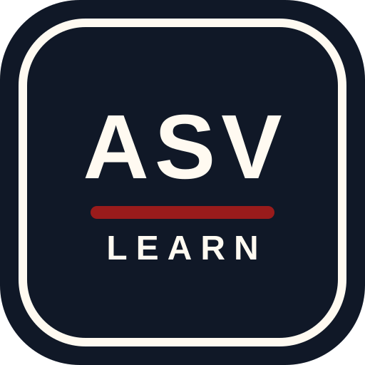

<p align="center">
  
</p>

<h3 align="center">ASV Labs Learn</h3>

<p align="center">Free learning platform for ASV Labs courses. Product branding and course content are ASV Labs.</p>

<p align="center"><small>LMS software is a private fork of <a href="https://github.com/learnhouse/learnhouse">LearnHouse</a> (AGPL-3.0).</small></p>

## Local community install

The live local instance uses Docker. Build and run from this repo (not upstream images) so ASV Labs branding is what learners see:

```bash
docker build -t asv-labs-learn:local .
# Then point ~/.learnhouse/local-community/docker-compose.yml
# learnhouse-app.image at asv-labs-learn:local and recreate the app container.
```

## Courses

See `content/courses/` and `scripts/` for catalog import, deepen assemblers, and Python Zero tooling.

- Locked product decisions: [`docs/PLATFORM-DECISIONS.md`](docs/PLATFORM-DECISIONS.md)
- Hetzner / learn.asv-labs.com handoff: [`docs/DEPLOY-HETZNER.md`](docs/DEPLOY-HETZNER.md)
- Local course UUIDs: `content/courses/learnhouse-course-ids.json`

**Canonical product:** https://learn.asv-labs.com — free forever, local-lab practice, all 13 courses public.
